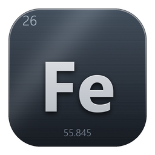
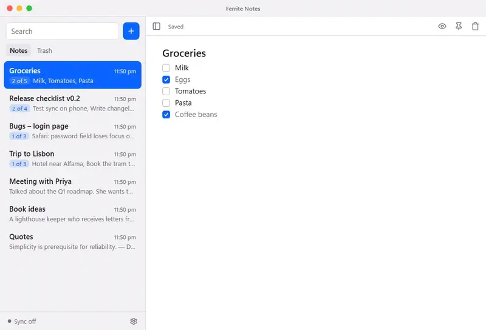
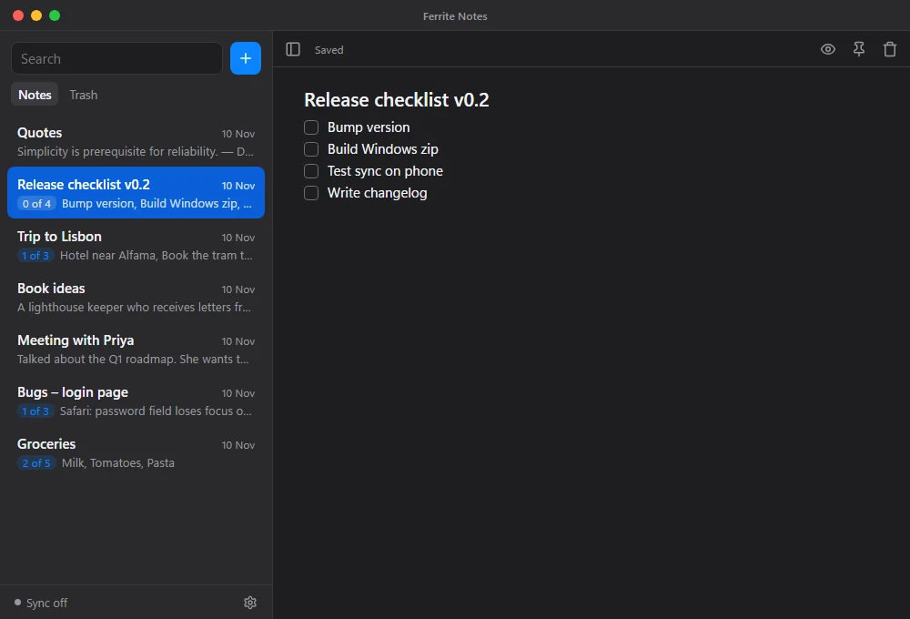
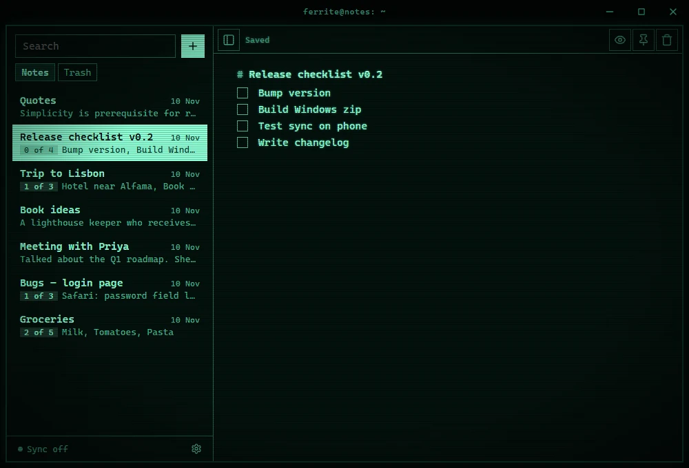
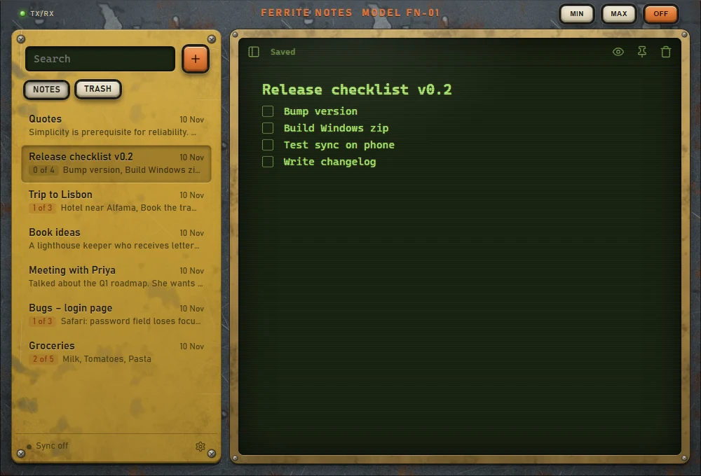
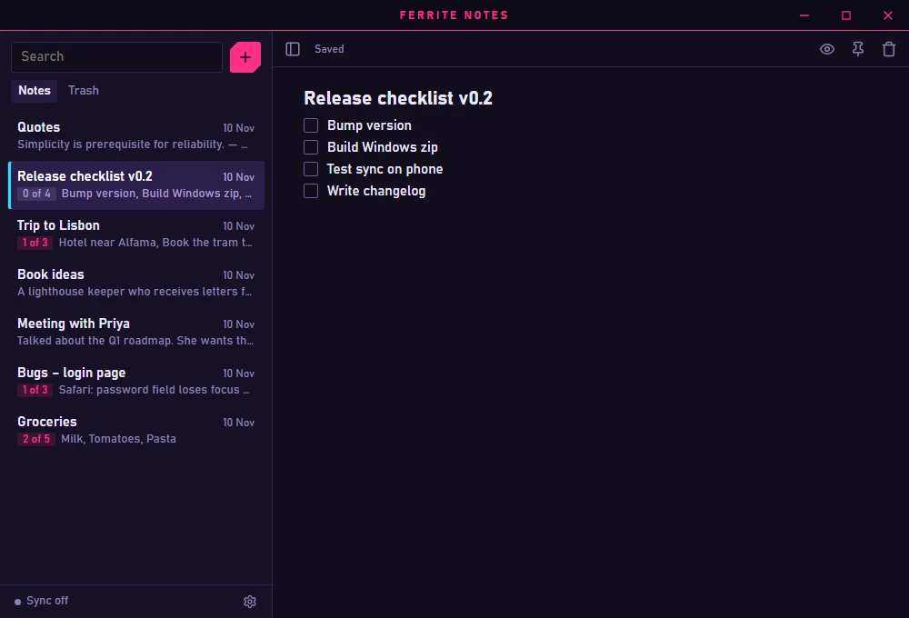
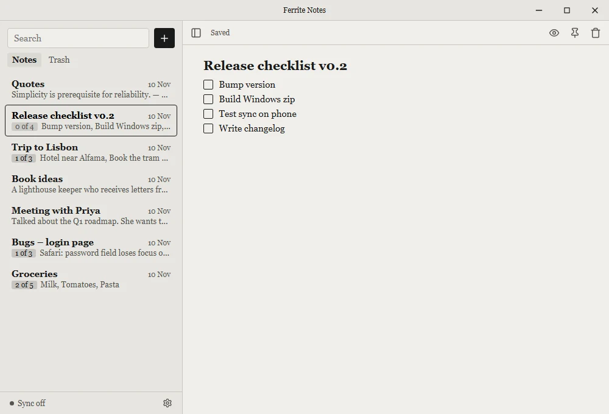

<div align="center">



# Ferrite Notes

Fast, light, offline-first notes for quick thoughts, task lists and bug lists.

Windows · macOS · Linux · Android

</div>



Ferrite Notes is a small notes app built with Rust and Tauri. It opens in about a third of a
second, works fully offline, and keeps your notes as plain Markdown in a local SQLite
database. If you want your notes on several devices, it syncs through a free Cloudflare
Worker that **you** run, so nobody else ever holds your notes.

Ferrite Notes is inspired by [Simplenote](https://simplenote.com): the same idea of fast,
plain notes that just sync, with tasks, themes and self-hosted sync added.

## Features

- **Tasks that click.** Type `[]` to start a task, click the box to tick it, or press
  `Ctrl+Enter` to tick every selected line. The list shows progress, like "2 of 5".
- **Markdown, quietly.** Write plain text; switch a note to preview for headings, tables,
  links and images.
- **Instant search** across every note (about 5 ms for 5,000 notes).
- **Pin, trash and restore.** Trash empties itself after 30 days.
- **Five themes:** macOS (light and dark), Gaming, a vintage phosphor Terminal, a worn
  cassette-futurism Retro, and E-ink (day and night). Each one draws its own title bar.
- **Offline first, optional sync** through your own free Cloudflare Worker.
- **Portable mode:** run it from a USB stick; everything stays in a folder next to the app.
- **Your data stays yours:** export every note as `.md` files in a zip, and get a daily
  backup of the last 7 days. No accounts, no tracking.
- **Small:** about 7 MB installed, a 3.4 MB portable zip.

## Themes

| | |
|---|---|
|  |  |
| macOS (dark) | Terminal |
|  |  |
| Retro | Gaming |
|  | |
| E-ink | |

Pick one in **Settings** (the gear at the bottom of the sidebar). macOS and E-ink follow
your system's light or dark mode, or you can fix one.

## Download

Get the latest version from the
[Releases](https://github.com/kasim393/ferrite-notes/releases) page: an installer or a
portable zip for Windows, an AppImage / `.deb` / `.rpm` for Linux, and a `.dmg` for macOS.

The builds aren't code-signed yet, so Windows SmartScreen may warn ("More info → Run
anyway") and macOS may need right-click → Open the first time. Instead, every file is
built by GitHub Actions from this repository's public code, with a published checksum and
a signed build attestation, so you can check exactly where it came from:

```bash
gh attestation verify Ferrite.Notes_0.1.1_x64-setup.exe --repo kasim393/ferrite-notes
```

You can also compare a download with the `SHA256SUMS-*.txt` file in the release
(`Get-FileHash <file>` in PowerShell, `shasum -a 256 <file>` on macOS and Linux).

## Build from source

You need [Rust](https://rustup.rs) (stable), [Node.js](https://nodejs.org) 20 or newer,
and the [Tauri prerequisites](https://v2.tauri.app/start/prerequisites/) for your system
(on Windows: Microsoft C++ Build Tools and WebView2, which Windows 10 and 11 already have).

```bash
git clone https://github.com/kasim393/ferrite-notes.git
cd ferrite-notes
npm install
npm run tauri dev        # run the app with live reload
npm run tauri build      # installers in src-tauri/target/release/bundle/
npm run package:portable # Windows portable zip in release/
```

Android needs Android Studio's SDK and NDK; see the Android notes in
[CLAUDE.md](CLAUDE.md#whats-left) and the checklist in [TESTING.md](TESTING.md).

## Sync between devices (optional)

Sync runs on a tiny Cloudflare Worker with a D1 database, on a free Cloudflare account that
you own. Setup takes about five minutes:

```bash
cd worker
npm install
npx wrangler login
npm run setup
```

It prints a **Sync URL** and a **Sync token**. Paste both into **Settings** on every device.
Details, costs (free for personal use) and troubleshooting are in
[worker/README.md](worker/README.md).

Sync is last-write-wins per note, and nothing is ever lost: if two devices edit the same
note, the other version is kept as a "Conflict copy".

## Portable mode

Put an empty file named `portable` (or `portable.txt`) next to `ferrite-notes.exe`. The app
then keeps all its data, including the WebView's, in a `data` folder beside it, and writes
nothing else to the computer. The portable zip already includes this file.

## Your data

- Notes live in a SQLite database: `%APPDATA%\com.ferritenotes.notes` on Windows (or the
  `data` folder in portable mode). **Settings → Your notes** shows the exact path.
- **Export all notes** writes a zip of plain `.md` files that any editor can open.
- A backup of the database is made once a day; the last 7 are kept in `backups/`.
- The app sends nothing anywhere except to your own sync server, if you set one up.
  Images from the web in a note's preview are downloaded from their sites, as in a browser.

## Keyboard shortcuts

| Keys | Action |
|---|---|
| `Ctrl+N` | New note |
| `Ctrl+F` | Search |
| `Ctrl+B` | Show or hide the sidebar |
| `Ctrl+P` | Preview or edit |
| `Ctrl+Shift+P` | Pin or unpin |
| `Ctrl+Enter` | Tick or untick the task(s) on the selected lines |
| `[]` at a line start | Start a task |
| `Ctrl+Backspace` (outside the editor) | Move the note to the trash |
| `Esc` | Clear the search |

On macOS, use `Cmd` instead of `Ctrl`.

## How it's built

- **Rust core** ([src-tauri](src-tauri)): SQLite with FTS5 search, sync client, export,
  backups, Markdown rendering (pulldown-cmark, sanitized with ammonia).
- **UI** ([src](src)): Svelte 5 and CodeMirror 6, plain CSS variables for themes, no UI
  library.
- **Sync server** ([worker](worker)): a Cloudflare Worker in TypeScript with D1.

[CLAUDE.md](CLAUDE.md) explains the architecture and the reasons behind the main decisions;
[PLAN.md](PLAN.md) is the original plan.

## Contributing

Bug reports, ideas and pull requests are welcome. Please read
[CONTRIBUTING.md](CONTRIBUTING.md) first. To report a security problem, see
[SECURITY.md](SECURITY.md).

## Thanks

- [Simplenote](https://simplenote.com), the inspiration for an app that stays out of your way.
- [Tauri](https://tauri.app), [Svelte](https://svelte.dev), [CodeMirror](https://codemirror.net),
  [SQLite](https://sqlite.org) and the other open-source projects this is built on.
- [Lucide](https://lucide.dev) for the icons.

## Why "Ferrite"?

Ferrite is a form of iron, a nod to Rust, the language it's built in. And it ends just like
"write", which is what you do here.

## License

[MIT](LICENSE) © 2026 Kasim. Icons adapted from [Lucide](https://lucide.dev) (ISC); see
[THIRD-PARTY-NOTICES.md](THIRD-PARTY-NOTICES.md).
